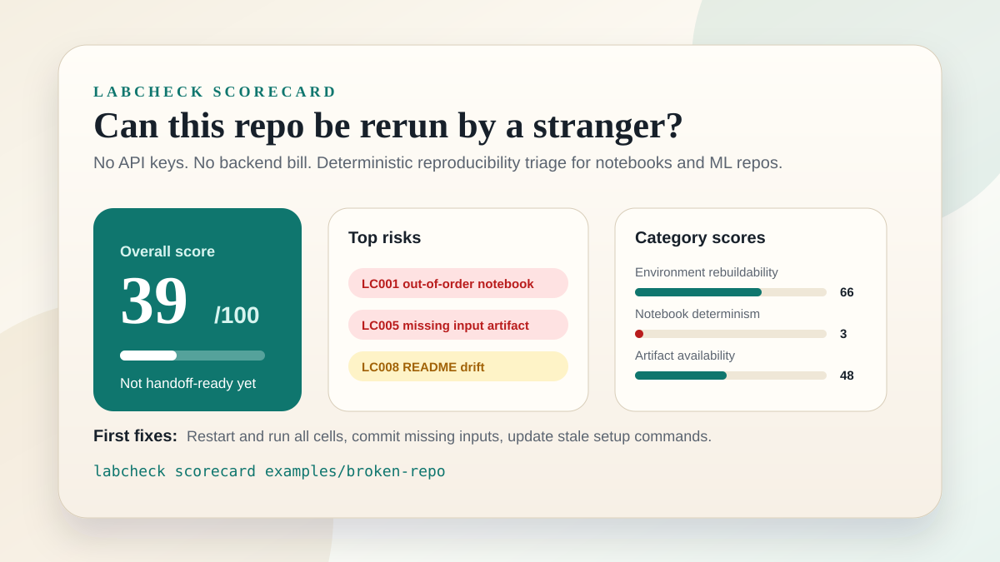

# labcheck

[](pyproject.toml)
[](docs/privacy-and-safety.md)
[](README.md)
[](LICENSE)

An open-source reproducibility auditor for research and ML repositories.

`labcheck` answers a simple question:

> If I hand this repo to a smart stranger, can they actually reproduce the results?



It scans notebooks, scripts, manifests, README instructions, and simple data lineage to surface the exact issues that make experiment-heavy repos fragile:

- hidden notebook state
- missing input artifacts
- mutable downloaded data URLs
- imported packages missing from manifests
- unpinned dependencies
- absolute machine-local paths, including Colab/Kaggle notebook paths
- README drift
- randomness without visible seeding
- committed outputs with no visible producer
- disconnected workflow files

No paid APIs. No inference bill. No backend secret to protect.

See [Privacy and Safety Model](docs/privacy-and-safety.md) for the browser-demo, CLI, GitHub Action, and public-deployment safety boundaries.

Input targets supported right now:

- local folder
- single notebook
- local `.zip` archive
- public GitHub repository URL
- GitHub Actions CI

Zip archives are extracted into a temporary directory with path traversal and symlink checks before scanning.

---

## Why this exists

A lot of repos look fine until a new student, reviewer, or engineer actually tries to run them.

That is where the real problems show up:

- notebooks only work because the original kernel still has invisible state
- datasets are referenced but not committed
- dependencies drift over time
- local editable/path dependencies point to files that were never shared
- figures and result files exist, but their provenance is unclear
- README commands point to files, modules, Makefile targets, DVC targets, Quarto render targets, Jupytext sync targets, Kedro pipelines, Ploomber tasks, Luigi tasks, Meltano jobs, Flyte workflow/task targets, Argo workflow/template targets, Tekton Pipeline/Task targets, Ray job entrypoints, Dagger functions, Bazel targets, Pants target specs, Nix flake outputs, Docker Compose services/env-files/project dirs/profiles, Docker build stages, Helm chart paths, Kustomize overlay/base paths, Kubernetes manifest paths, Terraform working directories, Pulumi project directories, Ansible playbooks/inventories, Packer template paths, Prefect flows, MLflow entry points, dbt model selectors, Great Expectations checkpoints, Dagster job/asset targets, Airflow DAG/task targets, Metaflow steps, package scripts, or project scripts that do not exist anymore
- GitHub Actions workflows point to missing scripts, dependency files, or Makefile targets

`labcheck` is built for that moment.

---

## Who it helps

### Professors and research labs

Use `labcheck` to see whether students and reviewers can rerun a repo without machine-specific assumptions or hidden notebook state.

### ML and data founders

Use `labcheck` to audit whether an experiment-heavy codebase is portable, reproducible, and safe to hand to a new engineer.

### OSS maintainers

Use `labcheck` to catch reproducibility issues before contributors get stuck on setup and broken artifact paths.

---

## Request a public repo audit

If you want a lightweight outside read on a public research, ML, data, or notebook-heavy repo, open an **Audit request** issue and include the public repository URL plus any known external datasets or archival folders.

The request path is intentionally narrow: public repos only, no private code upload, no API keys, and heuristic reproducibility signals rather than scientific judgment.

---

## What it produces

`labcheck` emits:

- an overall reproducibility score
- category scores
- a top-risk summary for quick review
- a prioritized remediation plan
- actionable findings with severity
- a simple provenance graph
- Markdown, CSV, JSON, HTML, SARIF, scorecard, target-fit, issue-draft, outreach-note, before/after compare, and audit-pack reports

Current categories:

- Environment Rebuildability
- Notebook Determinism
- Artifact Availability
- Portability
- Onboarding Readiness

Example scorecard:

```text
Overall score: 39/100
Scope: 1 notebook, 1 Python file
Findings: 14 (5 high, 7 medium, 2 low)
Weakest area: Notebook Determinism (3/100)

Top risks:
- LC001 suspicious notebook execution order
- LC002 likely hidden notebook state
- LC005 referenced input artifact missing from repo

Triage signal:
Not handoff-ready yet: fix 5 high-severity findings before sending this
repo to a reviewer, student, or new engineer.
```

---

## Checks implemented so far

- `LC001` suspicious notebook execution order
- `LC002` likely hidden notebook state
- `LC003` missing environment manifest
- `LC004` unpinned dependencies in `requirements.txt`, `pyproject.toml`, Conda environment files, and included Conda pip requirement files
- `LC005` missing input artifacts
- `LC053` input artifacts that exist locally but are covered by `.gitignore`
- `LC006` absolute machine-local paths, including Colab/Kaggle notebook paths
- `LC007` randomness without visible seeding
- `LC008` README command drift
- `LC062` Markdown links/images that point to missing local files
- `LC063` missing reuse license metadata
- `LC064` missing citation metadata for research/notebook-heavy repos
- `LC065` Docker Compose `depends_on` entries that reference missing services
- `LC066` Docker Compose service networks that reference missing top-level networks
- `LC067` Docker Compose healthchecks that reference missing local scripts
- `LC068` Docker Compose secrets/configs that reference missing local files
- `LC069` Docker Compose service `env_file` entries that reference missing local files
- `LC070` Docker Compose `extends` entries that reference missing local files or services
- `LC071` Docker Compose top-level `include` entries that reference missing local files
- `LC072` Docker Compose service `label_file` entries that reference missing local files
- `LC073` Docker Compose `develop.watch[].path` entries that reference missing local files or directories
- `LC009` committed outputs with no visible producer
- `LC010` disconnected workflow nodes
- `LC011` saved notebook error outputs
- `LC012` missing Python runtime version
- `LC013` missing setup or run instructions
- `LC014` notebooks with no saved execution evidence
- `LC015` notebooks missing kernel metadata
- `LC016` scikit-learn splitters and randomized estimators missing `random_state`
- `LC017` pandas sampling missing `random_state`
- `LC018` DVC/Git LFS metadata without documented restore steps or committed wrapper tasks
- `LC019` conflicting Python runtime declarations
- `LC020` inline notebook package installs without pins
- `LC048` inline OS package installs hidden in notebooks or scripts
- `LC021` dependency manifest present but setup step undocumented
- `LC022` mutable remote input/download data URLs
- `LC047` remote download calls with no explicit timeout
- `LC050` stable remote artifacts with no checksum or hash verification
- `LC042` Hugging Face model/dataset/download calls missing `revision=`
- `LC043` VCS dependencies that omit a ref or use moving branch refs, including Conda pip entries
- `LC023` missing requirements/constraints include files, including Conda pip includes
- `LC024` undocumented environment variables
- `LC054` hardcoded secret-looking API keys, tokens, passwords, or private key blocks
- `LC041` interactive `input()` / `getpass()` prompts that block unattended reruns
- `LC052` inline commands such as `%run` or `subprocess.run(...)` that call missing local scripts
- `LC051` persistent working-directory changes such as `os.chdir(...)` or notebook `%cd`
- `LC046` accelerator/GPU requirements missing from README/docs
- `LC025` CI workflow commands that reference missing paths
- `LC044` CI workflows that install/setup but never verify anything
- `LC026` CI Python version conflicts with project runtime
- `LC027` local dependency paths missing from the repo, including Conda pip entries
- `LC028` common imported dependencies missing from manifests
- `LC045` project-local helper imports missing from the repo
- `LC029` floating Docker base image tags
- `LC049` Python Dockerfiles that skip dependency manifests
- `LC030` floating GitHub Action references
- `LC031` PyTorch `random_split` calls missing a seeded generator
- `LC040` PyTorch `DataLoader(..., shuffle=True)` calls missing a seeded generator
- `LC058` PyTorch/CuDNN deterministic backend settings disabled
- `LC059` PyTorch `DataLoader(..., num_workers>0)` calls missing `worker_init_fn`
- `LC032` TensorFlow random calls missing a visible seed
- `LC033` XGBoost estimators missing `random_state` or `seed`
- `LC060` Optuna studies/samplers missing a seeded sampler
- `LC061` JAX random calls that reuse the same PRNG key without a visible split
- `LC034` Polars sampling/shuffle calls missing `seed`
- `LC074` LightGBM estimators and `lgb.train(...)` params missing visible seeds
- `LC075` CatBoost estimators missing `random_seed` or `random_state`
- `LC076` Keras shuffled dataset/generator calls missing `seed`
- `LC035` generated output directories missing before save/write calls
- `LC077` output/result/figure directories missing provenance notes or sidecars
- `LC036` glob/listdir input directories missing from the repo
- `LC037` timestamp-derived generated output filenames
- `LC055` current date/time calls used in workflow logic
- `LC038` unsorted glob/listdir/Path.glob input discovery order
- `LC056` set-derived ordering such as `list(set(...))` without sorting
- `LC057` built-in `hash()` calls used where stable splits, IDs, or seeds are expected
- `LC039` NumPy `default_rng()` calls missing an explicit seed

---

## Quick start

If you only try one path, run the intentionally broken demo repo first. It gives you a compact report with hidden notebook state, missing artifacts, README drift, and unseeded randomness in under a minute.

For the lowest-friction CLI install after the public repo is live, use the [install guide](docs/install.md). It covers `pipx` from GitHub, local development installs, public GitHub repo audits, and the browser-only path.

```bash
git clone https://github.com/ThomasAquinas14/labcheck.git
cd labcheck
python -m pip install -e .

labcheck doctor .
labcheck scorecard examples/broken-repo
labcheck scan examples/broken-repo
labcheck scan examples/broken-repo --format html --output report.html
```

If you installed with `pipx` and do not have the source checkout, generate the same kind of first-run fixture anywhere:

```bash
labcheck demo-repo
labcheck scorecard labcheck-demo-repo
```

For a real repo:

```bash
labcheck scan .
labcheck scorecard .
labcheck target-fit . --audience founder
labcheck pack . --output-dir labcheck-audit --zip
```

For CI:

```bash
labcheck init .
labcheck init . --policy
```

`labcheck init` creates a starter `.labcheck.toml` plus a soft-audit GitHub Actions workflow. Add `--policy` to also create `docs/reproducibility.md`, a ready-to-edit lab/team handoff policy. It does not overwrite existing files unless you pass `--force`.

For a public no-key demo URL, run:

```bash
python scripts/build_static_site.py
```

Then publish the generated `dist/site` folder. The export includes the landing page, browser demo, README, sample audits, and docs with links rewritten for static hosting.
It also includes share metadata, JSON-LD structured data, `robots.txt`, `sitemap.xml`, and `llms.txt` so the public demo has clean crawler and AI-tool entry points without adding a backend.

---

## Command cookbook

The CLI is intentionally broad enough for local use, CI, outreach, and static-site demos:

```bash
labcheck scan examples/broken-repo --format markdown
labcheck demo-repo
labcheck scorecard labcheck-demo-repo
labcheck target-fit labcheck-demo-repo --audience professor
labcheck scan examples/broken-repo --format markdown --max-findings 50
labcheck scan examples/broken-repo --format json
labcheck scan examples/broken-repo --format csv --output labcheck-findings.csv
labcheck scan examples/broken-repo --format markdown --output labcheck-report.md --json-output labcheck-report.json --csv-output labcheck-report.csv --scorecard-output labcheck-scorecard.md --target-fit-output labcheck-target-fit.md --issue-output labcheck-issue-draft.md
labcheck pack examples/broken-repo --output-dir labcheck-audit --zip
labcheck target-fit https://github.com/owner/repo --audience professor --output labcheck-target-fit.md
labcheck outreach examples/broken-repo --output labcheck-outreach-note.md
labcheck outreach examples/broken-repo --audience founder --output labcheck-founder-note.md
labcheck issue examples/broken-repo --output labcheck-issue-draft.md
labcheck scan examples/broken-repo --format sarif --output labcheck-report.sarif
labcheck scan examples/broken-repo --badge-output labcheck-badge.svg
labcheck badge examples/broken-repo --output labcheck-badge.svg
labcheck scan examples/broken-repo --fail-on high
labcheck scan examples/broken-repo --min-score 80
labcheck scan examples/broken-repo --config .labcheck.toml
labcheck baseline examples/broken-repo --output .labcheck-baseline.json
labcheck scan examples/broken-repo --baseline .labcheck-baseline.json --fail-on high --min-score 90
labcheck compare before-labcheck-report.json after-labcheck-report.json --output labcheck-compare.md
labcheck scan examples/broken-repo.zip
labcheck scan https://github.com/owner/repo
labcheck demo-link https://github.com/owner/repo
labcheck demo-link https://github.com/owner/repo --format markdown --auto-audit
labcheck graph examples/broken-repo
labcheck checks
labcheck checks --category determinism
labcheck checks --severity high
labcheck checks --search seed
labcheck explain LC005
labcheck explain LC005 --format markdown
labcheck explain LC005 --format json
python scripts/build_static_site.py
python scripts/build_sample_audits.py
python scripts/release_check.py
```

For local development without installing the console command, run `python -m labcheck.cli ...` with `PYTHONPATH=src`.

Maintainer note: `scripts/check_compare_smoke.py` accepts `LABCHECK_COMPARE_TMP_PREFIX` as an internal release-test override for isolating temporary compare artifacts during concurrent smoke runs.

Use `labcheck doctor .` when setting up a repo or demo environment. It checks the installed version, Python runtime, target path or public GitHub URL, optional config file, and registered check catalog before you run a full scan.

Use `labcheck checks` to list supported checks, `labcheck checks --category determinism` or `labcheck checks --severity high` to browse a focused subset, and `labcheck explain LC005` to see what a finding means, why it matters, and how to fix it. Add `--format markdown` for paste-ready issue/PR text, or `--format json` for automation.

Example `labcheck explain LC005` output:

```text
LC005 - Referenced input artifact missing from repo
Default severity: high
Category: artifacts
Detects: Code that reads local input files, or Docker Compose files that bind-mount local sources or build from local contexts, that are not present in the scanned repo.
Why it matters: A new user may not be able to run the workflow because required inputs are missing.
Suggested fix: Commit the artifact, document how to obtain it, or define the input contract explicitly.
```

This keeps finding codes safe to paste into issues, PR comments, outreach notes, or lab handoff checklists without asking maintainers to guess what `LC005` means.

Use `labcheck scorecard .` to create a compact Markdown summary for PR comments, lab handoff notes, founder due-diligence messages, or outreach follow-ups.

Use `labcheck target-fit . --audience professor` to decide whether a repo has enough static evidence for respectful cold outreach. It produces a 10-point fit score, concrete reasons, the top outreach hook, safe caveats, and next commands before you write a note.

Use `labcheck scan . --format csv --output labcheck-findings.csv` when a lab, founder, maintainer, or reviewer wants a sortable findings table for spreadsheet triage, owner assignment, or batch audit tracking. The CSV includes blank `status` and `owner` columns plus a `suggested_owner` hint based on the finding category.

Use `labcheck outreach . --output labcheck-outreach-note.md` to generate a polite, ready-to-edit outreach message with the score, top risk, and a clear caveat that the audit is a handoff/readiness signal rather than a scientific-validity judgment. Add `--audience professor`, `--audience founder`, or `--audience maintainer` to tailor the opening and ask. For public GitHub targets, the note also includes a bounded browser-demo link automatically.

Use `labcheck issue . --output labcheck-issue-draft.md` to generate a maintainer-friendly GitHub issue draft with a suggested title, top-risk triage section, reproducibility commands, and caveats that invite maintainers to close or scope the issue if the findings are expected. For public GitHub targets, the issue draft includes the same bounded browser-demo link plus full CLI reproduction commands.

Use `labcheck demo-link https://github.com/owner/repo` to generate a shareable browser-demo URL such as `https://thomasaquinas14.github.io/labcheck/demo.html?repo=owner%2Frepo` for low-friction outreach. Add `--audience professor`, `--audience founder`, or `--audience maintainer` to preselect the browser target-fit card, and add `--format markdown` or `--format html` when you want a paste-ready README, email, issue, or launch-post link.

Use `labcheck badge . --output labcheck-badge.svg` to generate a static score badge for README files or CI artifacts.

Use `labcheck compare before-labcheck-report.json after-labcheck-report.json --output labcheck-compare.md` to create a shareable before/after improvement note from two JSON reports. It shows score deltas, severity deltas, resolved findings, and new findings so a maintainer, lab, or team can prove cleanup progress after fixes.

Use `labcheck pack . --output-dir labcheck-audit --zip` to generate a shareable audit folder plus `labcheck-audit.zip` with a manifest, scorecard, target-fit card, issue draft, outreach note, Markdown, HTML, CSV, JSON, SARIF, a badge, and a small index file. This is the easiest format to attach to outreach, release notes, or a lab handoff.

Human-readable reports show the first 100 detailed findings by default so large notebook corpora stay readable in terminals and GitHub job summaries. Use `--max-findings all` when you want every detail. JSON, CSV, and SARIF outputs remain complete regardless of the human report cap.

You can also inspect the generated sample audits directly:

- [Markdown sample audit](docs/sample-audits/broken-repo-audit.md)
- [HTML sample audit](docs/sample-audits/broken-repo-audit.html)
- [Scorecard sample audit](docs/sample-audits/broken-repo-scorecard.md)
- [Target-fit sample](docs/sample-audits/broken-repo-target-fit.md)
- [Outreach note sample](docs/sample-audits/broken-repo-outreach-note.md)
- [Issue draft sample](docs/sample-audits/broken-repo-issue-draft.md)
- [Labeled issue bundle sample](docs/sample-audits/broken-repo-labeled-issue.md)
- [Static landing page](site/index.html)
- [Browser demo](site/demo.html)
- [Public case studies](docs/case-studies.md)
- [Reply-derived case study seed](docs/reply-derived-case-study-seed.md)
- [Reply to case study checklist](docs/reply-to-case-study-checklist.md)
- [Comparison guide](docs/comparison.md)
- [Demo video script](docs/demo-video-script.md)
- [FAQ](docs/faq.md)
- [First audit guide](docs/first-audit.md)
- [Reproducibility pattern gallery](docs/reproducibility-patterns.md)
- [Roadmap](docs/roadmap.md)
- [Scoring guide](docs/scoring-guide.md)
- [Good first issues](docs/good-first-issues.md)
- [GitHub publish guide](docs/github-publish-guide.md)
- [GitHub Action guide](docs/github-action.md)
- [Install guide](docs/install.md)
- [Lab and team adoption guide](docs/lab-adoption-guide.md)
- [Launch kit](docs/launch-kit.md)
- [Launch post after-action checklist](docs/launch-post-after-action.md)
- [Launch week plan](docs/launch-week-plan.md)
- [Outreach playbook](docs/outreach-playbook.md)
- [Outreach tracker template](docs/outreach-tracker-template.md)
- [Privacy and safety model](docs/privacy-and-safety.md)
- [Public deploy guide](docs/public-deploy-guide.md)
- [Release checklist](docs/release-checklist.md)
- [Citation metadata](CITATION.cff)

---

## GitHub Action

`labcheck` ships with a no-key GitHub Action wrapper. Start with a soft audit that uploads reports and writes the Markdown audit to the GitHub job summary without failing CI:

```bash
labcheck init .
labcheck init . --policy
```

The first command creates a starter `.labcheck.toml` and `.github/workflows/labcheck.yml`. The generated workflow requests only `contents: read`; no repository secrets or write permissions are needed for the default soft audit. The `--policy` variant also writes `docs/reproducibility.md` so a lab or team has a clear handoff standard. You can also wire the Action manually:

```yaml
- uses: actions/checkout@v4
- id: labcheck
  uses: ThomasAquinas14/labcheck@v1
  with:
    target: "."
    report-format: markdown
          report-path: labcheck-report.md
          json-path: labcheck-report.json
          csv-path: labcheck-report.csv
          sarif-path: labcheck-report.sarif
    badge-path: labcheck-badge.svg
    scorecard-path: labcheck-scorecard.md
    target-fit-path: labcheck-target-fit.md
    issue-draft-path: labcheck-issue-draft.md
    max-findings: "100"
    fail-on: none
    min-score: ""
```

For existing repos, create a baseline once with `labcheck baseline . --output .labcheck-baseline.json`, commit it, and then set `baseline-path: .labcheck-baseline.json` plus `fail-on: high` or `min-score: "80"` to catch regressions. The Action also writes `labcheck-scorecard.md` for PR summaries, `labcheck-target-fit.md` for outreach triage, `labcheck-issue-draft.md` for maintainer handoff, and SARIF for optional GitHub code scanning.

The Action exposes outputs such as `${{ steps.labcheck.outputs.overall-score }}`, `${{ steps.labcheck.outputs.findings-count }}`, `${{ steps.labcheck.outputs.high-count }}`, `${{ steps.labcheck.outputs.triage-signal }}`, and `${{ steps.labcheck.outputs.top-risk-id }}` for PR summaries, sticky PR comments, release summaries, or custom workflow logic. The full guide includes copy-paste snippets for `$GITHUB_STEP_SUMMARY` and one-comment-per-PR reporting.

If a repo has archived experiments, generated notebooks, checkpoints, or other intentional noise, add a `.labcheck.toml` file:

```toml
# Optional: use "education" for large course/tutorial repos. It downgrades the
# noisiest notebook-state checks and caps repeated tutorial-corpus findings.
profile = "default"

exclude = [
  "archive/**",
  "labcheck-audit/**",
  "notebooks/generated/**",
  ".ipynb_checkpoints/**",
]

# Use sparingly for known intentional patterns that would otherwise dominate
# the report with low-signal findings.
disabled_checks = [
  # "LC010",
]

# Prefer targeted suppressions when one known file intentionally keeps a finding.
[[ignored_findings]]
check_id = "LC010"
path = "archive/old_experiment.py"
reason = "Archival script kept for context, not a supported rerun path."

# Optional per-check severity and volume controls. Explicit values override
# profile defaults.
[severity_overrides]
# LC002 = "medium"

[finding_limits]
# LC010 = 25
```

The CLI discovers this file automatically for local folder scans. In GitHub Actions, pass `config-path: .labcheck.toml` to make the exclusion policy explicit.

See the full guide in [docs/github-action.md](docs/github-action.md).

---

## Example findings

From the current broken example repo:

- `LC002` hidden notebook state: cell 3 references `external_state` with no visible prior definition
- `LC011` saved notebook error output: the notebook is committed with a `NameError` traceback
- `LC005` missing artifact: notebook reads `data/train.csv`, Docker Compose bind-mounts `./data`, or a Compose service builds from `./app`, but the path is not present in the repo
- `LC065` broken Compose topology: a service declares `depends_on: [db]`, but `db` is not defined in the Compose file
- `LC066` broken Compose network wiring: a service joins `backend`, but the Compose file does not define a top-level `backend` network
- `LC067` broken Compose healthcheck: `healthcheck.test` calls `./scripts/healthcheck.sh`, but that script is not present in the repo
- `LC068` broken Compose resource file: `secrets.db.file` or `configs.app.file` points at a local file that is not present in the repo
- `LC069` broken Compose env file: a service declares `env_file: ./config/dev.env`, but that env file is not present in the repo
- `LC070` broken Compose inheritance: a service extends `base` or `compose.base.yml`, but the target service or file is missing
- `LC071` broken Compose include: top-level `include: ./compose/common.yml` points at a file missing from the repo
- `LC072` broken Compose label file: a service declares `label_file: ./labels/api.labels`, but that label file is missing
- `LC073` broken Compose watch path: `develop.watch[].path: ./src` points at a file or directory missing from the repo
- `LC008` README drift: a documented command points to a missing script, Python module, Makefile target, package script, project script, Hatch/PDM script, pixi/taskipy/Taskfile/Invoke/Just/doit/Rake task, tox environment, Snakemake target, Nextflow pipeline/profile/entry, WDL/Cromwell workflow input/root, CWL workflow/job file, Papermill input/parameter file, DVC stage/data target, Quarto render target, Jupytext sync target, Kedro pipeline, Ploomber task, Luigi task, Meltano job, Flyte workflow/task target, Argo workflow/template target, Tekton Pipeline/Task target, Ray job entrypoint, Dagger function, Bazel target, Pants target spec, Nix flake output, Docker Compose service/env-file/project dir/profile, Docker build stage, Helm chart path, Kustomize overlay/base path, Kubernetes manifest path, Terraform working directory, Pulumi project directory, Ansible playbook/inventory, Packer template path, Prefect flow, MLflow entry point, dbt model selector, Great Expectations checkpoint, Dagster job/asset target, Airflow DAG/task target, Metaflow step, or nox session
- `LC012` missing Python runtime version: runnable code exists, but the repo does not declare which Python version to use
- `LC010` workflow fragility: `experiment.py` is disconnected from visible lineage

This is exactly the kind of output that is useful in code review, onboarding, lab handoff, and due diligence.

There are also early public-repo case studies in [docs/case-studies.md](docs/case-studies.md).

---

## Project shape

`labcheck` is intentionally CLI-first:

- deterministic checks
- local-first usage
- public-hosting safe
- no per-user inference cost
- lightweight public-repo scanning for real-world trials

That makes it a better fit for:

- GitHub adoption
- CI usage now
- static demo hosting
- cold outreach to labs and founders

---

## Why it is different

Most tooling either lints code or scans dependencies.

`labcheck` focuses on **reproducibility as a system property**:

- can the environment be recreated?
- can the notebook run cleanly from top to bottom?
- are outputs traceable to inputs?
- will the next person actually know what to run?

That makes it much more useful for research and experiment-heavy repos than a generic lint pass.

---

## Current status

This repository is an early but real prototype:

- working CLI
- working tests
- sample Markdown and HTML audits
- top-risk summaries before long finding lists
- prioritized remediation plans for quick fix ordering
- capped human-readable details for large repos, while JSON/SARIF stay complete
- static SVG score badges for README/CI artifacts
- compact Markdown scorecards for PR comments, outreach, and handoff notes
- deterministic target-fit cards for prioritizing professor, founder, maintainer, or general outreach
- maintainer-friendly issue drafts for public repos and OSS follow-up
- shareable `labcheck pack` audit bundles for outreach and handoff
- self-explaining check catalog via `labcheck checks`, `labcheck checks --category determinism`, `labcheck checks --search seed`, `labcheck explain LC005`, and paste-ready `labcheck explain LC005 --format markdown`
- inline SVG provenance visualization
- static browser demo for notebooks, selected files, local folders, and bounded public GitHub URL audits
- one-click browser sample repo snapshot for no-prep demos
- downloadable browser-side scorecard, target-fit card, issue draft, outreach note, Markdown, CSV, and JSON reports
- self-contained static export for GitHub Pages, Netlify, Cloudflare Pages, or Oracle Object Storage
- `labcheck init` for one-command repo setup
- optional `labcheck init --policy` lab/team reproducibility policy pack
- no-key GitHub Action wrapper
- baseline-and-ratchet CI workflow
- optional minimum-score CI gate
- SARIF output for GitHub code-scanning integrations
- `.labcheck.toml` excludes and disabled-check controls for archived/generated noise control
- `LC009` orphan output detection for committed results and figures
- `LC018` DVC/Git LFS restore-step and wrapper-task hints for data-versioned repos
- `LC019` exact Python runtime conflict detection across setup files, Dockerfile variants, and nested Dockerfiles
- `LC020` inline notebook `%pip` / `!pip` install drift detection
- `LC048` inline OS package install detection for apt/brew/apk/yum-style setup
- `LC021` dependency setup-step detection for run-only READMEs
- `LC022` mutable remote data URL detection for branch/latest-style reads and downloads
- `LC047` remote download timeout detection for handoff/CI reliability
- `LC050` remote artifact checksum/integrity detection
- `LC042` Hugging Face model/dataset revision pin detection
- `LC043` moving VCS dependency ref detection
- `LC023` broken `-r` / `-c` requirements and Conda pip include detection
- `LC024` undocumented project-specific environment variable detection
- `LC054` hardcoded secret-looking value detection with masked report evidence
- `LC041` interactive prompt detection for unattended reruns
- `LC052` missing inline script-command detection for notebook and subprocess reruns
- `LC062` dead local Markdown link detection for README/docs handoff links
- `LC063` missing reuse license metadata detection
- `LC064` missing citation metadata detection for research/notebook-heavy repos
- `LC065` Docker Compose `depends_on` service validation
- `LC066` Docker Compose service-network validation
- `LC067` Docker Compose healthcheck script validation
- `LC068` Docker Compose secret/config file validation
- `LC069` Docker Compose service env_file validation
- `LC070` Docker Compose extends target validation
- `LC071` Docker Compose include file validation
- `LC072` Docker Compose service label_file validation
- `LC073` Docker Compose develop watch path validation
- `LC051` working-directory mutation detection for cwd-sensitive reruns
- `LC046` accelerator/GPU requirement documentation detection
- `LC025` GitHub Actions workflow command drift detection
- `LC044` GitHub Actions verification-step gap detection
- `LC026` GitHub Actions Python-version conflict detection
- `LC027` missing local editable/path dependency detection
- `LC028` common import-vs-manifest dependency drift detection
- `LC045` missing local helper-module import detection
- `LC029` floating Docker base image detection
- `LC049` Docker dependency-install gap detection
- `LC030` floating GitHub Action reference detection
- `LC031` PyTorch random_split generator detection
- `LC040` PyTorch DataLoader shuffle generator detection
- `LC058` PyTorch/CuDNN deterministic backend detection
- `LC059` PyTorch DataLoader worker seed-init detection
- `LC032` TensorFlow set_seed detection
- `LC033` XGBoost random_state/seed detection
- `LC060` Optuna seeded sampler detection
- `LC061` JAX PRNG key reuse detection
- `LC034` Polars sample/shuffle seed detection
- `LC074` LightGBM seed detection
- `LC075` CatBoost seed detection
- `LC076` Keras dataset/generator seed detection
- `LC035` generated output directory existence detection
- `LC077` generated output provenance-note detection
- `LC036` glob/listdir input directory detection
- `LC037` timestamped output path detection
- `LC055` current date/time workflow logic detection
- `LC038` unsorted file discovery order detection
- `LC056` set-derived order drift detection
- `LC057` unstable Python `hash()` usage detection
- `LC039` NumPy default_rng seed detection
- `LC053` gitignored input artifact detection for files that work locally but disappear from public clones
- CI workflow that tests the package and smoke-tests the Action
- public case studies on real repos
- a narrow, credible product wedge

Recently moved from future work into core:

- more framework-specific determinism checks: LightGBM, CatBoost, and Keras shuffled dataset/generator seed drift now have dedicated checks
- richer generated-result provenance: output/result/figure/model directories now get a directory-level provenance-note check, complementing orphan-output and write-path checks
- better noise control for large educational notebook corpora: `.labcheck.toml` now supports `profile = "education"`, `severity_overrides`, and `finding_limits`

---

## Roadmap

See the fuller public roadmap in [docs/roadmap.md](docs/roadmap.md).

Near-term:

- richer notebook hidden-state analysis
- more framework-specific determinism checks driven by real user fixtures beyond the current NumPy/sklearn/pandas/PyTorch/TensorFlow/XGBoost/Optuna/JAX/Polars/LightGBM/CatBoost/Keras coverage
- richer data-versioning guidance beyond DVC and Git LFS
- more public case studies with cleaner summaries
- GitHub Action marketplace polish

Later:

- richer lab/course policy packs
- VS Code or Jupyter integration

---

## Why this can be deployed publicly

This project was chosen very intentionally:

- no OpenAI/Anthropic/Gemini dependency
- no hidden API-key cost center
- no backend wallet-drain risk
- works well as a static page + local CLI combination

That means you can host a landing page and sample audits publicly without worrying that someone will exploit your inference budget.

---

## Contributing and security

Contributions are welcome, especially small reproducibility checks, false-positive reductions, docs, and public case studies.

- [Contributing guide](CONTRIBUTING.md)
- [Support guide](SUPPORT.md)
- [Code of Conduct](CODE_OF_CONDUCT.md)
- [Good first issues](docs/good-first-issues.md)
- [Issue label guide](docs/issue-labels.md)
- [Public triage board template](docs/public-triage-board.md)
- [Maintainer reply templates](docs/maintainer-reply-templates.md)
- [Launch post after-action checklist](docs/launch-post-after-action.md)
- [Reply-derived case study seed](docs/reply-derived-case-study-seed.md)
- [Reply to case study checklist](docs/reply-to-case-study-checklist.md)
- [Roadmap](docs/roadmap.md)
- [FAQ](docs/faq.md)
- [Security policy](SECURITY.md)

Please keep the core promise intact: no API keys, no paid service dependency, no default hosted backend, and deterministic checks that produce concrete evidence.

---

## Citation

If you use `labcheck` in a research, teaching, lab handoff, or reproducibility workflow, please cite it using [CITATION.cff](CITATION.cff).

---

## License

MIT. See [LICENSE](LICENSE).
